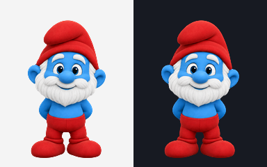
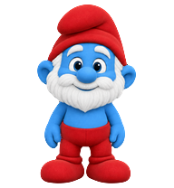

# סבא חכם · Saba Hacham 💙

A tiny, friendly blue elder to keep you company in Codex.

**[Download the clean pet package](dist/saba-hacham.zip)**

## התקנה

1. הורידו את [החבילה](dist/saba-hacham.zip) וחלצו אותה.
2. העתיקו את התיקייה `saba-hacham` לתוך תיקיית `pets` שב־Codex:
   - Windows: `%USERPROFILE%\.codex\pets\`
   - macOS / Linux: `~/.codex/pets/`
   - אם הגדרתם `CODEX_HOME` אחר, השתמשו בתיקיית `pets` שבתוכו.
3. בתוך התיקייה `saba-hacham` צריכים להיות `pet.json` ו־`spritesheet.webp`.

אם מותקנת גרסה קודמת, החליפו את שני הקבצים בגרסה הזו.

## Install

Download and extract the ZIP, then place its `saba-hacham` folder in `$CODEX_HOME/pets/` (by default `~/.codex/pets/`). The pet folder must contain both `pet.json` and `spritesheet.webp`. Replace those files when updating an existing installation.

## Animations

| Animation | What he does |
| --- | --- |
| Idle | Rests and blinks |
| Move right / left | Runs in either direction |
| Wave | Says hello |
| Jump | Crouches, jumps and lands |
| Failed | Looks disappointed |
| Waiting | Waits expectantly for your input |
| Working | Thinks with a hand at his beard |
| Review | Tilts his head and checks the result |

Also includes **16 clockwise gaze directions**.

## Package details

- Codex pet format: `spriteVersionNumber: 2`
- Atlas: 1536 × 2288 pixels, 8 columns × 11 rows
- Cell size: 192 × 208 pixels
- 9 animation rows, 16 gaze poses and a neutral frame
- Cleaned alpha edges; lossless WebP with transparency
- Structural atlas validation passed. Edge cleanup preserves the original pose arrangement and visible RGB colors.

The pet is an animated visual companion; conversation happens in Codex chat.

## Credits

Created with OpenAI image generation, assembled for Codex, and refined with local alpha-edge cleanup. Unofficial fan artwork inspired by Papa Smurf; not affiliated with the Smurfs rights holders.
